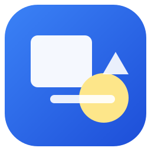

# Canvasity

Canvasity is a local, infinite-canvas whiteboard for the desktop. It is built
with Python 3 and PySide6 and stores everything on your machine — no accounts,
cloud services, telemetry, or cloud relay. Live collaboration uses a small local
TCP relay, so no hosted multiplayer service is involved.



## Features

- Infinite pan-and-zoom canvas with a grid, fit-to-screen, and cursor-anchored
  wheel zoom.
- Select, pen, eraser, sticky note, text, to-do checklist, project graph,
  rectangle, ellipse, line, arrow, and image tools.
- Interactive checklist cards with checkboxes, add/delete/edit task actions,
  progress bars, and per-action undo/redo.
- Project todo graphs with compact checkable todo nodes, dependency arrows,
  progress roll-up, auto-sizing frames, frame resizing, and undoable
  add/connect/delete actions.
- Move, resize, rotate, delete, duplicate, copy/paste, multi-select, group,
  and z-order controls.
- Undo/redo, keyboard shortcuts, colour pickers, pen width, text formatting
  (size, bold, italic, underline, alignment, colour), and snapping to the grid
  or to other objects.
- Board lifecycle: new, open, save, save as, rename, 30-second autosave,
  crash recovery, and PNG/PDF export.
- Live collaboration over a local TCP relay: start or join a session, see
  remote cursors, and sync board updates.
- Light and dark themes, plus a top toolbar, left tool palette, contextual
  properties panel, and zoom/selection status bar.

## Requirements

- Python 3.10 or newer
- PySide6 6.6 or newer

## Setup

```bash
cd /home/roman/projects/python/canvasity
python3 -m venv .venv
source .venv/bin/activate
pip install -r requirements.txt
python main.py
```

You can also install the project as a package:

```bash
pip install -e .
canvasity
```

To open a board directly:

```bash
python main.py path/to/board.canvasity
```

## Keyboard shortcuts

| Action | Shortcut |
| --- | --- |
| Select / Pen / Eraser | `V` / `P` / `E` |
| Sticky / Text / Checklist / Project graph | `S` / `T` / `C` / `G` |
| Rectangle / Ellipse / Line / Arrow | `R` / `O` / `L` / `A` |
| Insert image | `I` |
| Pan | Middle-drag or `Space` + drag |
| Zoom | Mouse wheel (at cursor) |
| Zoom in / out / actual size / fit | `Ctrl+=` / `Ctrl+-` / `Ctrl+1` / `Ctrl+0` |
| Undo / redo | `Ctrl+Z` / `Ctrl+Shift+Z` or `Ctrl+Y` |
| Cut / copy / paste / duplicate | `Ctrl+X` / `Ctrl+C` / `Ctrl+V` / `Ctrl+D` |
| Delete | `Delete` or `Backspace` |
| Select all | `Ctrl+A` |
| Group / ungroup | `Ctrl+G` / `Ctrl+Shift+G` |
| Save / save as / open / new | `Ctrl+S` / `Ctrl+Shift+S` / `Ctrl+O` / `Ctrl+N` |
| Rename board | `F2` |
| Toggle dark mode | `Ctrl+Shift+T` |

While editing text, normal text-editing keys (including `Ctrl+Z` and `Ctrl+V`)
apply to the editor instead of the canvas.

## Live collaboration

Canvasity supports live collaboration without a hosted relay. The local relay
listens on `0.0.0.0:8765` and exchanges newline-delimited JSON messages:

- `hello` carries the joining client’s user details and board snapshot.
- `board` carries a full board snapshot from one client to the others.
- `cursor` carries cursor movement from one client to the others.

Board updates are full-snapshot updates, which keeps the protocol simple while
still allowing every participant to add to or modify the shared board.

### Starting and joining a session

- Start the collaboration server from the `View` menu. The app starts a local
  relay and joins the current board as the local user.
- To collaborate from another device or app instance, choose
  `Join Collaboration…` and enter the server host and port.
- Within a local network, use the host machine’s LAN IP address and port `8765`.
- Over the internet, run the host on a machine with a publicly reachable IP and
  open TCP port `8765`, then forward that port to the host. The joining client
  uses the host’s public IP address and port `8765`.

The host is responsible for running the relay; there is no cloud relay or hosted
service. No accounts or authentication are used, so the relay is intended for
trusted local or private-network use.

### Stopping a session

Choose `Stop Collaboration` to leave the active session. The local relay stops,
the status returns to `Offline`, and the board returns to local-only operation.

## Board files

Boards use the `.canvasity` extension and are human-readable JSON:

```json
{
  "format": "canvasity",
  "version": 1,
  "name": "My board",
  "items": []
}
```

Images are embedded as base64 PNG data, so a board is a single self-contained
file. Saves are atomic: Canvasity writes a temporary file and replaces the
target only after the write succeeds.

Autosaves are stored next to saved boards as `<board>.canvasity.autosave`.
Unsaved work is recovered from the platform application-data directory on the
next launch. A recovered autosave newer than the board file is offered when the
board is opened.

## Project layout

```
canvasity/
  app.py                 application bootstrap and error hook
  config.py              constants, defaults, paths
  theme.py               light/dark palettes and stylesheet
  canvas/                scene, view, undo commands
  network/               local TCP collaboration relay and client
  objects/               board items, checklists, project graphs, inline editors
  tools/                 one class per tool
  storage/               atomic JSON load/save and autosave helpers
  export/                PNG and PDF rendering
  ui/                    main window, properties panel, icon factory
  assets/icons/          application logo and generated icon resources
tests/                   headless core, tool, storage, export, and collaboration tests
```

The canvas layer (`canvas/`, `objects/`, `tools/`, `storage/`) does not depend
on the main window and can be used without the UI.

## Tests

Run the headless test suite:

```bash
QT_QPA_PLATFORM=offscreen python -m unittest discover -s tests -v
```

## Notes and limitations

- The canvas is practically infinite, bounded to ±50,000 scene units.
- Erasing removes whole pen strokes rather than partial stroke segments.
- Text boxes resize horizontally and grow vertically; sticky notes resize in
  both directions. Checklist cards resize horizontally and grow as tasks are
  added.
- Checklist cards support checkboxes, task add/edit/delete, and progress. Task
  text is single-line; long text is elided on the card.
- Project graphs grow automatically as todos are added or moved, and you can
  resize the frame with selection handles. Drag a todo body to arrange it, drag
  its right-edge circle onto another todo to add a dependency arrow, and hover
  a link to reveal its remove button. Project titles and todo text are
  single-line; long text is elided on the node.
- Groups move, copy, delete, and reorder as a unit; resizing is done per item.
- Renaming a board changes its display name inside the file, not the filename.
- Live collaboration uses self-hosted TCP relays and full board snapshots; cross-device
  use requires the host’s IP address and port forwarding, not a cloud service.
- When switching themes, items that still use the previous theme's default
  text/stroke colour are updated so they remain readable.
